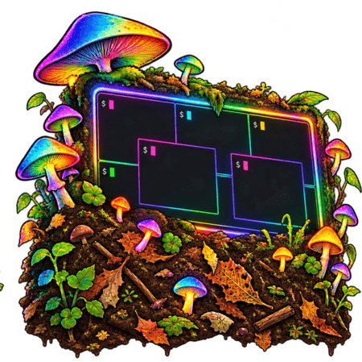

# compo

This is a terminal compositor.  This is merely a program that shows shell windows in whatever terminal you're in. You can freely move them for when they are floating, and "dock them" into a tiled layout. This tool was written so that you can have a mix of "static" panes (like a sidebar) that stay in place, while hosting a persistent mechanism (like tmux) where windows and sessions can change. In my case, I use a sidebar to control tmux and detect process events, but don't want a change in the tmux layout or session to also change the sidebar. This was a pain in tmux alone, especially when wanting to use multiple terminals to access tmux sessions as a different tmux display against the same server and different sessions. Also, I didn't want to rely on the native terminal's ability to split panes, since this isn't available remotely over a single session. Also, kitty passthrough doesn't quite work in tmux yet. 


A Zig window-management core owns geometry, tiling, docking, floating windows, focus, and visibility without knowing about terminals. A terminal adapter supplies libghostty-vt emulation and Kitty graphics.

The host starts with an empty desktop. Create floating shells, drag them into nested tiles, or reserve edge walls for controllers. Each shell keeps the same process while its layout changes.

## Building (needs zig 0.17.0)

$ zig build

$ ./zig-out/bin/compo


## Testing

The project pins Zig 0.17.0 through `mise.toml` and declares the same minimum
in `build.zig.zon`. The longer-term migration of tmux's own build is separate.

```sh
mise install
mise run test
mise run demo
mise run demo-vt
```

The demo prints a static layout with numbered windows. It needs no terminal
control, tmux server, or libghostty-vt. The core supports split-tree tiles,
ordered edge docks, constrained floats, independent always-on-top ordering,
visibility regions, focus, and pointer capture. See [core API notes](docs/core-api.md)
for ownership, bounds, and initial limitations.

## Run the shell

```sh
mise run shell
```

The desktop starts empty. **Ctrl-] then Enter** creates a floating `$SHELL`.
Click a window, or press **Ctrl-] then Tab**, to switch focus. Ctrl-] twice
sends a literal Ctrl-] to the shell. Ordinary keys, including your tmux prefix,
pass through to the focused shell.

- Option-left-drag moves a window. On a tiled border it pulls the tile out.
- Drag over the directional zones of a tile to split it, or near a workspace edge to split the whole layout. A muted gray-blue preview shows the target. Release to dock; Escape cancels the drag. New splits divide the target equally.
- Option-Control-left-drag moves freely across the full screen without docking.
- For a wall drop, start an Option-drag, then release Option and hold Control at a workspace edge.
- Drag a shared tile divider to resize both sides; drag a floating border or corner to resize that float.
- `exit` closes a shell; closing the last returns to the desktop.
- **Ctrl-] then q** quits the compositor and closes all its shells.

`TMUXPP_LEGACY=1` starts the earlier sidebar/main layout. `TMUXPP_SINGLE=1` starts a full-root shell; `TMUXPP_FLOAT=1` starts sidebar, main, and floating shells. `TMUXPP_DESKTOP=1` forces an empty desktop when using command environment variables for testing.

To install optimized binaries at predictable paths:

```sh
mise exec -- zig build -Doptimize=fast
./zig-out/bin/compo
```

Use `-Doptimize=small` for the smaller build. `zig build` also installs `terminal-demo` and `layout-demo` under `zig-out/bin/`.

The legacy left dock is up to 24 columns wide and shrinks on narrow displays. This host is tested on macOS. An optional floating shell is available with `TMUXPP_FLOAT=1`; Alt-left-drag moves it, dragging a border resizes that edge, and Ctrl-] then `f` hides or shows it. The default `aurora` style uses a pink–violet–teal gradient and rounded floating corners. Set `COMPO_BORDER_STYLE=plain` for the original cyan/gray borders.
Borders brighten on hover; the dock and main terminal share one draggable divider. Detach/reattach and complete Kitty graphics rendering are not implemented. See [shell host notes](docs/shell-host.md) for the exact supported behavior.

`demo-vt` replays terminal output, shows the retained text screen, and confirms that a Kitty image is retained. It is a headless replay, not an interactive shell or image renderer. `zig build test-core` and `zig build test-vt` run the two layers separately; `mise run test` also runs renderer round-trip tests. `mise run test-host` builds the shell and runs disposable-PTY integration checks. See [terminal adapter notes](docs/terminal-adapter.md).

The standalone libghostty-vt release is pinned in `vendor/` and used by the terminal adapter. It also requires Zig 0.17.0. Run `mise run deps-check` to check for release updates and the OSC 7501/3008 embedder hooks. See [dependency notes](vendor/README.md).

## Optional tmux reference checkout

The standalone compositor builds without a tmux checkout. The separate upstream
experiment uses a local Git checkout in `vendor/tmux`, currently at
`a864c419900182fe624abf73db72ae6f1b0ab9a5` from https://github.com/tmux/tmux.
It reports `next-3.9` and already includes native side status. No C changes are
needed to try its session/window list. See [the design notes](docs/sidebar-design.md)
for what exists and what remains to investigate.

## Distribution goals

Keep SIMD enabled. Target fully static musl builds for broad Linux compatibility,
Windows builds needing only built-in system DLLs with no runtime installer, and macOS builds using the built-in libSystem. See the [distribution policy](docs/roadmap.md#distribution-policy) for baseline and release-validation requirements.

## Control protocol

The persistent local socket supports window discovery, creation, floating placement, layers, focus, stacking, and removal. Child shells receive its path in `COMPO_SOCKET`. Use `COMPO_HEADLESS=80x24` for a disposable host without a physical terminal. Screen observation and injected input are the next stage. See
[the current interface](docs/control-protocol.md) and [the development spec](specs/00-control-proto.md).
